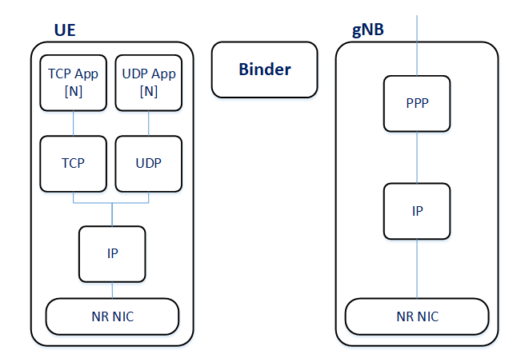

Architecture Overview
=====================

.. TODO: This chapter covers: The 3GPP entities mapped to Simu5G modules; RAN and core; user plane and control plane; what is modeled as signaling and what as a direct call; the network-level modules.

The Binder
----------

The ``Binder`` (``src/simu5g/common/binder/``) is the directory of the
cellular network. It assigns and resolves the node identifier space (the
"MAC node IDs" used throughout the stack), and records:

*  which UE is attached to which cell,
*  master/secondary relationships for dual connectivity,
*  X2 peerings between base stations,
*  D2D multicast group membership.

Modules query the Binder at runtime -- for example, a receiving PHY asks it
which other cells transmit on the same carrier in order to compute
inter-cell interference. The Binder is pure infrastructure: it has almost no
user-facing parameters, and a simulation user normally only needs to know
that it must be present, and that a node's *node id* (as used in
``servingNodeId`` or ``masterId``) is assigned by it in order of
registration.

.. TODO: describe how node ids are assigned (numbering scheme for eNBs/gNBs
   and UEs) -- users need this to set servingNodeId/masterId confidently.

Notes on module references
--------------------------

All references to global modules from inside nodes are parameters -- e.g.
every stack module has a ``binderModule`` parameter defaulting to
``"binder"``. If you name the global modules differently in your network, or
run multiple cellular networks side by side, set these parameters
accordingly.

Architecture at a glance
------------------------

An end-to-end Simu5G scenario contains some or all of the following elements:

*  *User Equipments* (UEs) -- mobile hosts with a full TCP/IP protocol stack
   and a cellular network interface;
*  *base stations* -- gNBs (5G) and/or eNBs (4G), possibly interconnected via
   the *X2 interface* for handover and interference coordination;
*  *core network* nodes -- UPFs (or, for LTE, PGWs) that tunnel user traffic
   between the base stations and the external data network;
*  standard INET nodes -- routers, servers, switches -- making up the rest of
   the network;
*  a few *global modules* instantiated once per network: the ``Binder`` (a
   directory of all cellular nodes), the ``CarrierAggregation`` module
   (describing the component carriers in use), and the ``BearerConfigurator``
   (bearer and QoS-flow configuration).

Base stations can be organized in StandAlone (SA) or Non-StandAlone (NSA)
deployments. In an SA deployment, gNBs connect directly to the 5G core; in an
NSA (EN-DC) deployment, a gNB acts as secondary node of an LTE eNB, which is
connected to the Evolved Packet Core, and NR traffic reaches the gNB through
the eNB via X2. These deployment options are described in
:doc:`deployments`.
