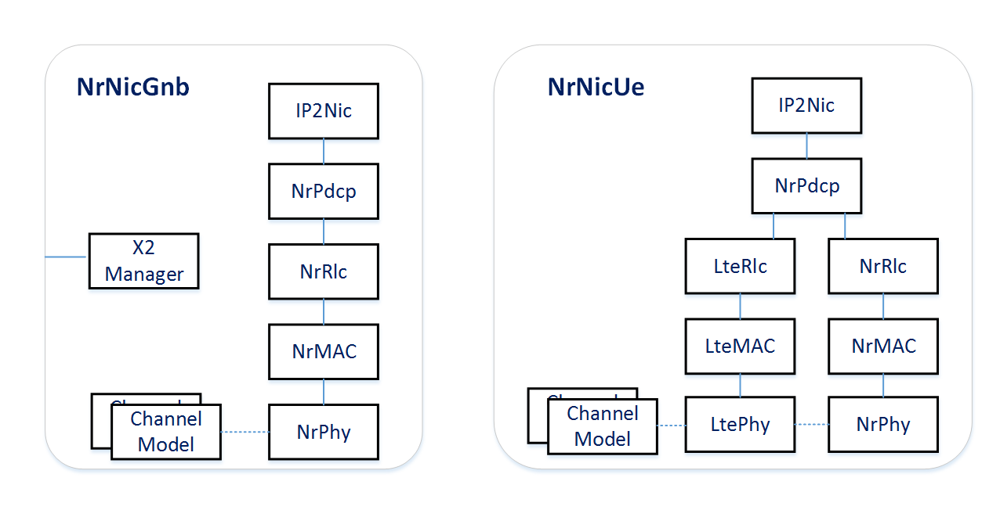

The Cellular NIC
================

.. TODO: This chapter covers: The anatomy of the NIC types, the path of a packet through the submodules, the replaceable parts.

The cellular NIC
----------------

The heart of every UE and base station is the cellular NIC, a compound
module implementing the LTE/NR protocol stack. Concrete NIC types exist per
node role and technology -- ``LteNicUe``, ``LteNicEnb``,
``NrNicUe``, ``NrNicEnb``, plus D2D-capable variants of all four --
and all of them implement the ``ICellularNic`` module interface, so they
are interchangeable via the ``cellularNic.typename`` parameter.

Inside the NIC, one submodule per protocol layer is instantiated: SDAP
(where applicable), PDCP, RLC, MAC and PHY, together with supporting modules
(the IP-to-NIC adapter, the RRC module which owns bearer state and the
handover controller, and packet-flow observers used for statistics). The NR
UE NIC contains *two* stacks -- an LTE leg and an NR leg -- sharing a common
entry point, which is what enables dual connectivity and EN-DC operation.

The per-layer models are described in their own chapters
(:doc:`qos`, :doc:`pdcp`, :doc:`rlc`, :doc:`mac`,
:doc:`phy`).
