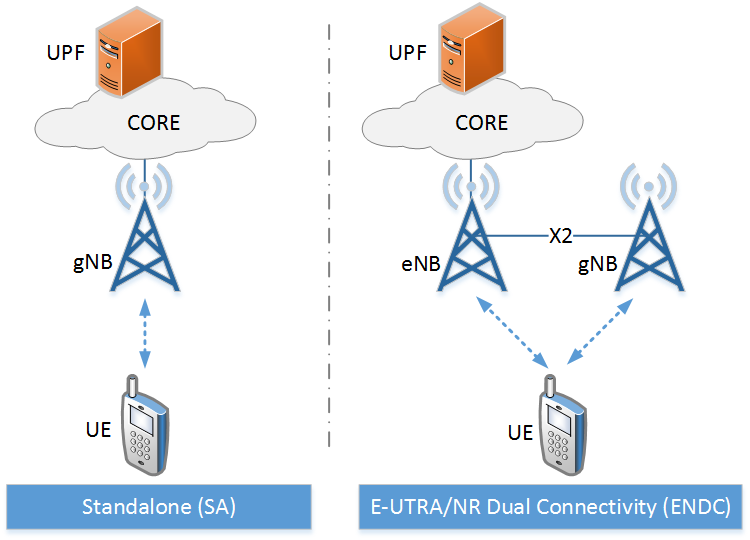

Deployment Options
==================

Overview
--------

This chapter shows how complete cellular networks are assembled from Simu5G
components, and how the standard deployment options of 3GPP TR 38.801 map to
Simu5G network descriptions: 5G standalone, LTE, and the two flavors of
dual connectivity between LTE and NR. The node types themselves are described
in :doc:`ue`, :doc:`base-station` and :doc:`core-network`.

Simu5G ships a reference network for each deployment option, under
``simulations/nr/networks/`` and ``simulations/lte/networks/``. They are good
starting points for custom networks: most example simulations use them, and a
new scenario can often start by copying one.

Anatomy of a Simu5G network
---------------------------

A Simu5G network consists of three groups of modules:

*  the network-level modules that exist once per cellular network:
   ``binder``, ``coreControl``, ``bearerConfigurator``,
   ``carrierAggregation`` and ``radioMedium`` (see :doc:`architecture`), plus
   INET's IP address configurator;

*  the cellular nodes: UEs, base stations, UPFs or a P-GW;

*  ordinary INET nodes for the rest of the network, typically a router and a
   server representing the data network.

The 5G standalone reference network, :ned:`SingleCell_Standalone`, shows all
three:

.. code:: ned

   network SingleCell_Standalone
   {
       parameters:
           radioMedium.numCarriers = carrierAggregation.numComponentCarriers;
           int numUe = default(1);
           int numBgCells = default(0);
           **.cellularNic.hasSdap = default(true);
       submodules:
           configurator: Ipv4NetworkConfigurator;
           ipv6Configurator: <default("")> like IL3NetworkConfigurator
               if typename != "";
           binder: Binder;
           coreControl: CoreControl;
           bearerConfigurator: BearerConfigurator;
           carrierAggregation: CarrierAggregation;
           radioMedium: CellularRadioMedium;
           server: StandardHost;
           router: Router;
           upf: Upf;
           iUpf: Upf;
           gnb: gNodeB;
           bgCell[numBgCells]: BackgroundCell;
           ue[numUe]: NrUe;
       connections:
           server.pppg++ <--> Eth10G <--> router.pppg++;
           router.pppg++ <--> Eth10G <--> upf.dnPppg;
           upf.pppg++ <--> Eth10G <--> iUpf.pppg++;
           iUpf.pppg++ <--> Eth10G <--> gnb.ppp;
   }

Three lines of the network's parameters are part of every Simu5G network:

*  The radio medium has one channel model per component carrier, so its
   ``numCarriers`` parameter is set from the number of carriers in
   ``carrierAggregation``.

*  Whether the cellular stacks have an SDAP layer depends on the core network:
   SDAP belongs to a stack connected to a 5G core (3GPP TS 37.324), so the
   networks with a :ned:`Upf` core set ``hasSdap`` to true for every cellular
   NIC, and the networks with an EPC leave it false.

*  ``numUe`` and ``numBgCells`` let the configuration choose the number of UEs
   and of background cells (see :doc:`background`) without editing the
   network.

The wiring follows the 3GPP reference points: the data network connects to the
anchor UPF's N6 gate (``dnPppg``), the UPFs connect to each other and to the
base stations' core network gate (``ppp``) with ordinary links, and base
stations connect to each other through their ``x2`` gates. The UEs have no
wired connections at all: they reach their base stations through the radio
medium.

5G standalone (SA)
------------------

In a standalone deployment (option 2 of TR 38.801), the gNBs connect directly
to the 5G core. :ned:`SingleCell_Standalone`, shown above, has one gNB, the
anchor UPF ``upf``, which faces the data network, and an intermediate UPF
``iUpf`` between the anchor and the gNB. Any number of intermediate UPFs and
routers can be placed between the anchor and the base stations: they forward
the tunneled traffic as IP packets.

:ned:`MultiCell_Standalone` has two gNBs behind the same intermediate UPF,
joined by an X2 link, which makes handover between them possible.

The UEs of a standalone network are :ned:`NrUe` modules whose NR leg is
attached to a gNB:

.. code:: ini

   *.ue[*].nrServingNodeId = 1    # the node id of the gNB

LTE
---

An LTE network uses :ned:`eNodeB` base stations, :ned:`LteUe` terminals and a
:ned:`PgwStandard` as the EPC's gateway. :ned:`SingleCell` is the minimal LTE
network: one eNB connected to the P-GW, which faces a router and a server.
:ned:`MultiCell` has two eNBs joined by an X2 link, and
:ned:`MultiCell_X2Mesh` three eNBs in a full X2 mesh. The
LTE UEs are attached with their ``servingNodeId`` parameter.

E-UTRA/NR dual connectivity (EN-DC)
-----------------------------------

In an EN-DC deployment (options 3 and 3a of TR 38.801), an LTE eNB is the
*master node* and a gNB its *secondary node*. Only the master is connected to
the core network, an EPC; the secondary contributes its radio leg over the X2
link to the master. The UEs are :ned:`NrUe` modules with both legs attached:
the LTE leg to the master, the NR leg to the secondary.

The reference network is :ned:`SingleCell_withSecondaryGnb`:

.. code:: ned

   pgw: PgwStandard;
   masterEnb: eNodeB;
   secondaryGnb: gNodeB;
   ue[numUe]: NrUe;
   ...
   pgw.pppg++ <--> Eth10G <--> masterEnb.ppp;
   masterEnb.x2++ <--> Eth10G <--> secondaryGnb.x2++;

The master/secondary relationship is configured on the secondary node, whose
``masterId`` parameter names the master by its node id, and dual connectivity
is enabled in every NIC with ``dualConnectivityEnabled``. The master eNB uses
NR PDCP entities, because the bearers it terminates have a leg on the NR
side:

.. code:: ini

   *.secondaryGnb.masterId = 1
   **.dualConnectivityEnabled = true
   *.masterEnb.cellularNic.ip2nic.isNr = true
   *.masterEnb.cellularNic.rrc.bearerManagement.pdcpEntityModuleType = \
           "simu5g.stack.pdcp.NrPdcpEntity"

   *.ue[0].servingNodeId = 1      # the LTE leg, at the master eNB
   *.ue[0].nrServingNodeId = 2    # the NR leg, at the secondary gNB

The X2 link needs X2 applications at both ends (see `X2 links`_ below). How
traffic is distributed over the two legs is the subject of
:doc:`dual-connectivity`. :ned:`MultiCell_withSecondaryGnb` combines two EN-DC
pairs.

NR-E-UTRA dual connectivity (NE-DC)
-----------------------------------

NE-DC (option 4 of TR 38.801) is the mirror image of EN-DC: a gNB is the
master node and an eNB its secondary. As TS 37.340 prescribes, an NR master
pairs with a 5G core, so the master gNB is connected to a :ned:`Upf`, and the
stacks have SDAP. The reference network is :ned:`SingleCell_withSecondaryEnb`:

.. code:: ned

   upf: Upf;
   iUpf: Upf;
   masterGnb: gNodeB;
   secondaryEnb: eNodeB;
   ue[numUe]: NrUe;
   ...
   iUpf.pppg++ <--> Eth10G <--> masterGnb.ppp;
   masterGnb.x2++ <--> Eth10G <--> secondaryEnb.x2++;

The UE's NR leg attaches to the master and its LTE leg to the secondary. The
secondary eNB has no core network link of its own, but its ``gateway``
parameter still has to name an existing node, so the configuration points it
at the UPF:

.. code:: ini

   *.secondaryEnb.masterId = 1
   **.dualConnectivityEnabled = true
   *.secondaryEnb.gateway = "upf"

   *.ue[0].nrServingNodeId = 1    # the NR leg, at the master gNB
   *.ue[0].servingNodeId = 2      # the LTE leg, at the secondary eNB

X2 links
--------

Base stations that cooperate -- for handover, dual connectivity or CoMP --
must be connected through their ``x2`` gate vectors. Each X2 link is a
point-to-point connection between two base stations, and each new connection
uses the next gate index on both sides:

.. code:: ned

   gnb1.x2++ <--> Eth10G <--> gnb2.x2++;

Each end of the link also needs an X2 application, one per peer, which carries
the X2 control messages over SCTP. The applications are configured in the ini
file: their number, the server port of each, and the address each client
connects to, which is the peer's X2 interface (``x2ppp0`` for its first X2
link):

.. code:: ini

   *.gnb*.numX2Apps = 1    # one X2 application per peer
   *.gnb*.x2App[*].server.localPort = 5000 + ancestorIndex(1)
   *.gnb1.x2App[0].client.connectAddress = "gnb2%x2ppp0"
   *.gnb2.x2App[0].client.connectAddress = "gnb1%x2ppp0"

The X2 protocol stack of the base stations is described in :doc:`x2`.

Example simulations
-------------------

The reference networks are used by the example simulations under
``simulations/nr/`` and ``simulations/lte/``. In particular:

*  ``simulations/nr/standalone`` and ``simulations/nr/standalone_multicell``
   use the 5G standalone networks;

*  ``simulations/nr/dualConnectivity`` and
   ``simulations/nr/dualConnectivity_multicell`` use the EN-DC networks, and
   the ``NeDualConnectivity`` configurations of
   ``simulations/nr/dualConnectivity`` the NE-DC network;

*  the configurations under ``simulations/lte/`` use the LTE networks.

Fidelity
--------

*  Of the deployment options of TR 38.801, the reference networks cover option
   1 (LTE), option 2 (5G standalone), options 3 and 3a (EN-DC) and option 4
   (NE-DC). Options 5 and 7, in which an eNB connects to a 5G core, have no
   reference network and no example simulation.

*  The EPC is reduced to the P-GW, which also ends the tunnels from the eNBs;
   there is no separate S-GW.

*  The X2 links are ordinary point-to-point links: their bandwidth and delay
   are those of the channel type that connects them.
