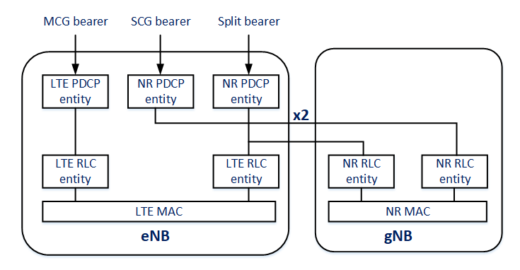

Dual Connectivity
=================

Overview
--------

Multi-radio dual connectivity (MR-DC; 3GPP TS 37.340) lets a UE use the radio
resources of two base stations at once. The master node (MN) holds the UE's
control-plane connection to the core network, and the secondary node (SN) is
connected to the master over Xn, or over X2 when the master is an eNB. Each
node serves the UE with a cell group: the master cell group (MCG) and the
secondary cell group (SCG). The flavors are named after the technologies of
the two nodes and the core network: EN-DC (an LTE master and an NR secondary,
with an EPC), NGEN-DC (the same with a 5G core), NE-DC (an NR master and an
LTE secondary, with a 5G core) and NR-DC (two NR nodes). The main functions
of MR-DC are the bearer types, the bearer termination, the routing of a
split bearer's PDUs over the two legs, and the procedures that add, change and
release the secondary node. A bearer is an MCG bearer, an SCG bearer, or a
split bearer that uses both cell groups, and its PDCP terminates at either node
(MN-terminated or SN-terminated). For a split bearer, the uplink stays on a
primary path until the data waiting in the UE exceeds a split threshold, and
the downlink split is decided by the node that holds the PDCP, with flow
control over Xn (TS 38.425).

Simu5G models EN-DC and NE-DC. The secondary node is paired with its master
by configuration, and the master installs the secondary's part of each bearer.
All three bearer types are available, chosen in the bearer's definition, and
every bearer is MN-terminated: its PDCP entity is at the master, and a relay
entity at the secondary carries its PDUs to and from the master over X2. A
split bearer's uplink follows the primary path and the data split threshold,
and above the threshold uses the less loaded leg or a configurable
expression; its downlink takes the leg a configurable per-PDU expression
chooses, a Simu5G extension, or stays on the primary path. SN-terminated
bearers and the downlink flow control over Xn are not modeled. NR-DC is not
possible, because a UE has a single NR leg, and NGEN-DC has no reference
network.

This chapter describes how a master and a secondary node are paired, how the
bearer types are chosen and how a split bearer routes its traffic, and what
happens inside the nodes. The reference networks of EN-DC and NE-DC are
described in :doc:`deployments`, the bearer definitions in :doc:`qos`, and the
PDCP mechanics of a split bearer in :doc:`pdcp`.

Pairing the master and the secondary
------------------------------------

A base station becomes the secondary node of another with its ``masterId``
parameter, which names the master by its node id (see :doc:`architecture` for
how node ids are assigned). Dual connectivity is enabled in the NICs with
``dualConnectivityEnabled``, which adds the modules that carry a bearer's data
between the two nodes. The two nodes need an X2 link with X2 applications at
both ends (see :doc:`deployments`).

Only the master has a link to the core network: the UE's traffic enters and
leaves the radio access network there, and the master forwards the part that
takes the secondary's cell group over X2.

The UE is an :ned:`NrUe`, whose two legs attach to the two nodes: the leg of
the master's technology to the master, the other to the secondary. A
secondary leg attaches only to a secondary node of the master that its other
leg is attached to; it ignores the beacons of the secondary nodes of other
masters.

The two flavors differ in their technologies and their core network:

EN-DC
   The master is an :ned:`eNodeB`, connected to an EPC (:ned:`PgwStandard`),
   and the secondary a :ned:`gNodeB`. The stacks have no SDAP, and the bearers
   are defined as ``"epc"`` bearers, selected by packet filters. The master
   terminates bearers that have an NR leg, so it uses NR PDCP entities:

   .. code:: ini

      *.secondaryGnb.masterId = 1
      **.dualConnectivityEnabled = true
      *.masterEnb.cellularNic.ip2nic.isNr = true
      *.masterEnb.cellularNic.rrc.bearerManagement.pdcpEntityModuleType = \
              "simu5g.stack.pdcp.NrPdcpEntity"

NE-DC
   The master is a :ned:`gNodeB`, connected to a 5G core (:ned:`Upf`), and the
   secondary an :ned:`eNodeB`. The stacks have SDAP, and the bearers are
   ``"5gc"`` bearers, selected by QFI; the SDAP headers cross both legs. The
   secondary has no core network link, but its ``gateway`` parameter must
   still name an existing node:

   .. code:: ini

      *.secondaryEnb.masterId = 1
      **.dualConnectivityEnabled = true
      *.secondaryEnb.gateway = "upf"

Bearer types
------------

The cell groups that serve a bearer are the ``legs`` field of its definition
in the :ned:`BearerConfigurator` (see :doc:`qos`):

``legs: ["MCG"]``: an MCG bearer
   The bearer uses the master's cell group only, like a bearer without dual
   connectivity.

``legs: ["SCG"]``: an SCG bearer
   The bearer's radio leg is the secondary's cell group. Its PDCP still
   terminates at the master, which relays every PDU to and from the secondary
   over X2.

``legs: ["MCG", "SCG"]``: a split bearer
   The bearer can use both legs. Its PDCP entity at the master feeds both its
   own RLC and, over X2, the secondary's RLC, and the UE's PDCP entity joins
   the two streams.

A definition that does not state its legs gets both, and so is a split bearer
that stays on its primary path, the master cell group, unless it is told to
split. An element of ``legs`` can also be an object that overrides the leg's
RLC configuration, for example ``{leg: "SCG", rlcMode: "AM"}``.

   The bearer types of EN-DC, all terminated at the master eNB. In the example
   configurations, the master uses NR PDCP entities for every bearer.

Routing a split bearer
----------------------

A split bearer's routing is configured in its definition, separately for the
two directions:

*  ``primaryPath`` (``"MCG"`` by default) is the leg the bearer uses whenever
   it is not splitting.

*  In the uplink, the UE keeps to the primary path until the data waiting in
   the bearer's RLC buffers on both legs reaches ``ulDataSplitThreshold``
   (TS 38.323 5.2.1); above it, each PDU takes the less loaded leg, or the
   leg that the ``ulLegSelection`` expression returns. The threshold is
   ``"infinity"`` by default, so the uplink does not split unless it is set;
   with 0, every PDU is routed by the selection.

*  In the downlink, the master cannot see the queue of the secondary's leg,
   so there is no threshold: without ``dlLegSelection``, the bearer stays on
   the primary path, and with it, each PDU takes the leg the expression
   returns.

A leg selection expression is written as ``expr(...)`` over
``packetOrdinal``, the running count of the bearer's PDUs, and returns the leg
number, 0 or 1. For example, ``expr(packetOrdinal % 2)`` alternates the PDUs
between the two legs. The expressions are a Simu5G extension: 3GPP steers the
downlink of a split bearer by flow control over Xn, which is not modeled.

Inside the nodes
----------------

Every dual connectivity bearer is terminated at the master. Its pieces are:

*  **At the master,** the bearer's PDCP entity, whose leg splitter
   (:ned:`DcPdcpLegSplitter`) chooses the leg of each downlink PDU. A PDU
   for the secondary's leg goes through the NIC's ``pdcpDcMux``
   (:ned:`DcMux`) to the dual connectivity X2 forwarder
   (:ned:`DcX2Forwarder`), which tunnels it over X2-U. In the uplink, the
   entity's leg joiner (:ned:`PdcpLegJoiner`) merges the PDUs of its own RLC
   with those the secondary relays back.

*  **At the secondary,** a PDCP relay entity (:ned:`PdcpRelayEntity`) in
   place of the PDCP entity: it passes the PDUs from the master to the local
   RLC entity, and the uplink PDUs from that RLC entity back to the master,
   with no PDCP processing of its own.

*  **At the UE,** one PDCP entity with both legs local, one on the RLC of each
   stack. Its leg splitter routes the uplink, and its leg joiner merges the
   two downlink streams.

At both ends, the NR receiving entity restores the order of the merged stream
by sequence number (see :doc:`pdcp`).

The master sets these pieces up itself when the bearer is established: it
installs the bearer's secondary part at the secondary node and at the UE
through their control-plane entry points, which stands for the SN Addition and
Modification of TS 37.340. For each bearer that has a secondary leg, it also
sets up two X2-U tunnels, one per direction, whose tunnel endpoint ids the
receiving end allocates. Nothing of this needs configuration beyond the
bearer's definition.

How the two legs of a UE hand over is described in :doc:`handover`: a
secondary leg can move to another secondary node of the same master, and a
master leg's handover detaches the secondary leg first.

Configuration
-------------

The pairing of the two nodes is shown above, and the complete reference
setups in :doc:`deployments`. The following tasks come from
``simulations/nr/dualConnectivity``.

**Carry a bearer on the secondary only.** An SCG bearer, from
``DualConn-ScgBearer-DL``:

.. code:: ini

   *.bearerConfigurator.onDemandDrbs = [{coreNetwork: "epc", isDefault: true, \
           rlcMode: "UM", legs: ["SCG"]}]

**Alternate the downlink between the legs.** From ``DualConn-SplitBearer-DL``:

.. code:: ini

   *.bearerConfigurator.onDemandDrbs = [{coreNetwork: "epc", isDefault: true, \
           lcg: 0, rlcMode: "UM", legs: ["MCG", "SCG"], \
           dlLegSelection: "expr(packetOrdinal % 2)"}]

**Split the uplink by load.** With the threshold at 0, the UE weighs both legs
for every PDU and takes the less loaded one; from
``DualConn-SplitBearer-Threshold-UL``:

.. code:: ini

   *.bearerConfigurator.onDemandDrbs = [{coreNetwork: "epc", isDefault: true, \
           lcg: 0, rlcMode: "UM", legs: ["MCG", "SCG"], primaryPath: "MCG", \
           ulDataSplitThreshold: 0}]

**Put two flows of one UE on different bearer types.** In
``DualConn-MasterPlusSecondary-DL``, one flow, selected by its type of
service, rides a split bearer pinned to the secondary (``primaryPath: "SCG"``,
never split), and the default flow its split bearer on the master.

Statistics
----------

Dual connectivity has no statistics of its own. Each leg's traffic is
recorded by the RLC and MAC of the node that serves it, so the share of the
two legs shows in the RLC and MAC statistics of the master and the secondary
(see :doc:`rlc` and :doc:`mac`).

Example simulations
-------------------

*  ``simulations/nr/dualConnectivity``: one EN-DC pair, with a configuration
   for each bearer type and routing policy (``DualConn-MasterOnly``,
   ``DualConn-SecondaryOnly``, ``DualConn-MasterPlusSecondary``,
   ``DualConn-SplitBearer``, ``DualConn-McgBearer``, ``DualConn-ScgBearer``,
   most of them in both directions), and the NE-DC configurations
   (``NeDualConn-*``),
   among them ``NeDualConn-MultiQfi-DL`` and ``-UL``, where SDAP headers cross
   both legs;

*  ``simulations/nr/dualConnectivity_multicell``: two EN-DC pairs, with
   handovers.

Fidelity
--------

*  EN-DC and NE-DC are modeled. NR-DC is not possible, since a UE has one NR
   leg, and NGEN-DC has no reference network.

*  Every bearer is MN-terminated; SN-terminated bearers, and the variants in
   which the secondary node has its own link to the core network (options 3a,
   3x and 4a of TR 38.801), are not modeled.

*  The downlink of a split bearer is routed by a per-PDU expression or kept on
   its primary path; the flow control over Xn of TS 38.425, by which the
   secondary node reports its queue to the master, is not modeled.

*  The secondary node is paired with its master by configuration. The SN
   Addition, Modification and Release procedures are not modeled as such: the
   master installs the secondary's part of each bearer by direct calls when
   the bearer is established, and the secondary leg attaches and hands over on
   its own measurements (see :doc:`handover`).

*  The X2 link between the master and the secondary is an ordinary link: its
   delay and bandwidth are those of its channel type.
