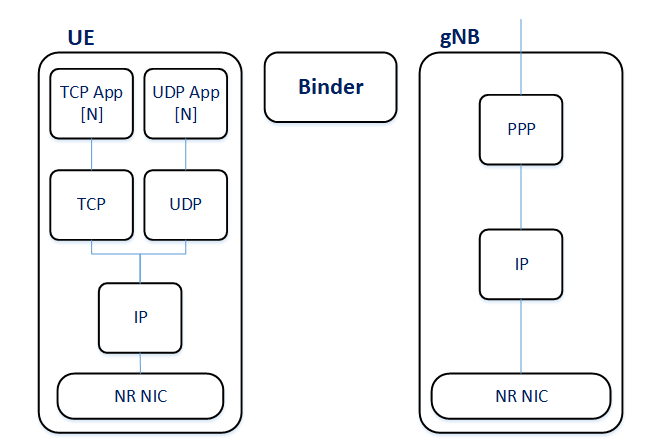

Introduction
============

What is Simu5G
--------------

Simu5G is a simulation model library for 5G New Radio (NR) and LTE/LTE-A
networks, built on the `OMNeT++ <https://omnetpp.org>`__ simulation framework
and the `INET Framework <https://inet.omnetpp.org>`__. It is the evolution of
the popular `SimuLTE <https://simulte.omnetpp.org>`__ 4G simulator, developed
by the same research group, and remains able to simulate pure LTE networks as
well as mixed 4G/5G deployments.

Simu5G provides a collection of models with well-defined interfaces which can
be instantiated and connected to build arbitrarily complex simulation
scenarios. Because Simu5G nodes are INET-compatible network hosts, a scenario
can freely combine cellular elements with the rest of the INET model library:
routers, Ethernet links, wireless LANs, TCP/UDP applications, mobility models,
and so on. Simu5G adds the 4G/5G radio access network (RAN) and the data plane
of the core network to the INET ecosystem.

The main features are:

*  5G NR (release 16) data plane: SDAP, PDCP, RLC, MAC and PHY layers of the
   NR protocol stack, at both gNBs and UEs
*  LTE/LTE-A data plane, inherited from SimuLTE and fully interoperable with
   the NR models
*  Standalone (SA) and Non-Standalone (E-UTRA/NR Dual Connectivity, EN-DC)
   deployments
*  QoS-flow and data-radio-bearer (DRB) based traffic handling, with
   configurable bearer profiles modeled after standard 5QI/QCI characteristics
*  Resource scheduling in uplink and downlink, with a set of pluggable
   scheduling policies
*  Carrier Aggregation (CA) with per-carrier numerologies, FDD and TDD
*  Realistic, customizable channel models (3GPP TR 36.873 / TR 38.901 style
   path loss, shadowing, fading), inter-cell interference, CQI reporting, and
   BLER-curve based reception modeling
*  Handover over the X2 interface between base stations
*  Network-assisted device-to-device (D2D) communications, one-to-one and
   one-to-many
*  An ETSI Multi-access Edge Computing (MEC) model, with MEC orchestrator,
   MEC hosts, and standard-compliant MEC services
*  Real-time emulation mode: real applications can exchange their traffic
   through an emulated 5G network
*  Background cells and background UEs for lightweight modeling of
   interference and cell load at scale

Scope and modeling philosophy
-----------------------------

Simu5G models the *data plane* (user plane) of the mobile network. Control
plane protocols such as RRC signaling messages, NAS, or the control-plane
interfaces of the core network (AMF, SMF, etc.) are not simulated as message
exchanges; where their *effects* matter for the data plane -- bearer
establishment, handover decisions, cell association -- they are modeled as
abstract procedures or configuration. This keeps simulations lightweight and
focused on the questions Simu5G is designed for: radio resource management,
scheduling, QoS, interference, mobility, and end-to-end application
performance over a 5G network.

Similarly, the core network is represented by its user-plane elements only:
User Plane Functions (UPFs) route traffic between gNBs and the Internet via
GTP tunneling, while the functions of control-plane core elements are folded
into configuration-time procedures.

The physical layer follows the same philosophy: instead of simulating
individual OFDM symbols, Simu5G computes per-resource-block SINR from
configurable channel models and maps it to reception probabilities using Block
Error Rate (BLER) curves. This abates computational complexity by orders of
magnitude while preserving the accuracy of the results; Simu5G's PHY model has
been validated against the 3GPP calibration guidelines of RP-180524.

Architecture at a glance
------------------------

An end-to-end Simu5G scenario contains some or all of the following elements:

*  *User Equipments* (UEs) -- mobile hosts with a full TCP/IP protocol stack
   and a cellular network interface;
*  *base stations* -- gNBs (5G) and/or eNBs (4G), possibly interconnected via
   the *X2 interface* for handover and interference coordination;
*  *core network* nodes -- UPFs (or, for LTE, PGWs) that tunnel user traffic
   between the base stations and the external data network;
*  standard INET nodes -- routers, servers, switches -- making up the rest of
   the network;
*  a few *global modules* instantiated once per network: the ``Binder`` (a
   directory of all cellular nodes), the ``CarrierAggregation`` module
   (describing the component carriers in use), and the ``BearerConfigurator``
   (bearer and QoS-flow configuration).

Base stations can be organized in StandAlone (SA) or Non-StandAlone (NSA)
deployments. In an SA deployment, gNBs connect directly to the 5G core; in an
NSA (EN-DC) deployment, a gNB acts as secondary node of an LTE eNB, which is
connected to the Evolved Packet Core, and NR traffic reaches the gNB through
the eNB via X2. These deployment options are described in
:doc:`networks`.

Relationship to OMNeT++ and INET
--------------------------------

Simu5G is not a standalone program: it is a model library that requires
OMNeT++ and builds on INET. Working knowledge of both is assumed throughout
this manual. In particular, novice users should first become familiar with:

*  the OMNeT++ *Simulation Manual* and IDE documentation (NED language, INI
   files, running simulations, recording and analyzing results);
*  the INET *User's Guide* (network nodes, applications, transport and
   network protocols, mobility).

This manual concentrates on what Simu5G adds on top: the cellular network
nodes, the NR/LTE protocol stack, and the features built around them.

About this manual
-----------------

This manual is written for users who assemble and run simulations using the
components provided by Simu5G, configuring them via NED and INI files. It
describes the models -- what is implemented, what is simplified, and which
parameters control what -- and deliberately avoids restating the 3GPP
specifications themselves; where appropriate, the relevant specification
numbers are cited so the reader can consult the standard.

For a reference of all modules and their parameters, consult the NED
documentation generated from the source code (*neddoc*). For complete,
runnable scenarios, see the example simulations under the ``simulations/``
directory of the Simu5G source tree, and the showcases and tutorials on the
Simu5G website.
