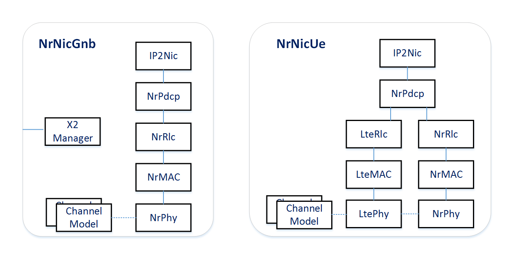

Network Nodes
=============

Overview
--------

This chapter describes the node types provided by Simu5G: terminals (UEs),
base stations (eNBs and gNBs), and the user-plane core network nodes. All of
them are INET-compatible compound modules -- they contain the standard INET
transport and network layers, interface tables and mobility submodules -- so
everything the INET documentation says about hosts and routers applies to
them as well. What makes them cellular nodes is the *cellular NIC*, plus a
handful of supporting submodules described below.

User equipment
--------------

Terminals are modeled by two node types, defined in ``src/simu5g/nodes/``:

*  ``LteUe`` -- an LTE-only terminal;
*  ``NrUe`` -- extends ``LteUe`` into a dual-stack terminal that can
   attach to an eNB, to a gNB, or to both at once (dual connectivity).

A UE is essentially a mobile INET host. Its submodules include:

*  a vector of applications (``app[numApps]``), which can be any INET
   ``IApp``-compatible module -- INET's own applications and Simu5G's traffic
   models (see :doc:`apps`) alike;
*  UDP, TCP and SCTP transport protocols and an IPv4 (optionally IPv6)
   network layer, all from INET;
*  the ``cellularNic`` module implementing the LTE/NR protocol stack --
   ``LteNicUe`` for ``LteUe``, ``NrNicUe`` for ``NrUe`` (or their
   D2D-capable variants when ``hasD2D = true``);
*  a ``mobility`` submodule, accepting any INET mobility model;
*  optional loopback and Ethernet interfaces; the latter
   (``eth[numEthInterfaces]``) defaults to ``ExtLowerEthernetInterface`` and
   is chiefly used in emulation setups (:doc:`emulation`).

Cell association
~~~~~~~~~~~~~~~~

Which base station serves a UE is configured through node-level parameters:

*  ``servingNodeId`` -- the node id of the serving eNB (the LTE leg);
*  ``nrServingNodeId`` -- the node id of the serving gNB (the NR leg,
   ``NrUe`` only).

Either leg can be left unattached. An ``NrUe`` with both parameters set is
a dual-connectivity UE; one with only ``nrServingNodeId`` set is a
standalone-5G terminal. Automatic, measurement-based initial cell selection
is available via the ``dynamicCellAssociation`` parameter of the UE's
handover controller (a submodule of the NIC's RRC module), in which case
the UE re-associates with the strongest cell at initialization; the
statically configured serving node id still serves as the starting point.

Vehicular variants
~~~~~~~~~~~~~~~~~~

``LteCar`` and ``NrCar`` extend the two UE types with mobility driven
by the `Veins <https://veins.car2x.org/>`__ vehicular simulation framework
(``VeinsInetMobility``). They are used in the ``cars`` example simulations.
For traffic-light-controlled vehicular mobility without Veins, see
:doc:`handover`.

Base stations
-------------

Base stations are modeled by:

*  ``eNodeB`` -- the 4G base station;
*  ``gNodeB`` -- the 5G base station, which extends ``eNodeB`` and
   differs mainly in the NIC variant it instantiates and in its default
   gateway (``upf`` instead of ``pgw``).

A base station combines three groups of functionality:

**The RAN side.** The ``cellularNic`` module (``LteNicEnb`` /
``NrNicEnb``, or D2D variants) implements the base-station side of the
protocol stack and communicates with all attached UEs over the radio channel.
The ``cellInfo`` submodule holds per-cell information, and the ``mobility``
submodule (stationary by default) gives the cell its position.

**The core network side.** User traffic to and from the core network travels
in GTP tunnels. The ``trafficFlowFilter`` submodule classifies outgoing IP
datagrams and the ``gtpUser`` submodule encapsulates/decapsulates them into
GTP-U packets, which are sent over the ``pppIf`` interface towards the
gateway node (parameter ``gateway``, e.g. ``"upf"`` or ``"pgw"``).

**The X2 side.** For each X2 connection to a peer base station, the node has
a PPP interface (``x2ppp[]``); X2 applications (``x2App[]``, one per peer)
run on top of an SCTP stack and carry the X2 control messages used by
handover and dual connectivity. A separate GTP entity, ``gtpUserX2``,
forwards in-flight user-plane data to the target cell during handover.

Key parameters include ``masterId`` (making the node a secondary node of the
given master, see :doc:`dual-connectivity`), ``txPower``, and ``hasD2D``
(selecting the D2D-capable NIC, see :doc:`d2d`).

The cellular NIC
----------------

The heart of every UE and base station is the cellular NIC, a compound
module implementing the LTE/NR protocol stack. Concrete NIC types exist per
node role and technology -- ``LteNicUe``, ``LteNicEnb``,
``NrNicUe``, ``NrNicEnb``, plus D2D-capable variants of all four --
and all of them implement the ``ICellularNic`` module interface, so they
are interchangeable via the ``cellularNic.typename`` parameter.

Inside the NIC, one submodule per protocol layer is instantiated: SDAP
(where applicable), PDCP, RLC, MAC and PHY, together with supporting modules
(the IP-to-NIC adapter, the RRC module which owns bearer state and the
handover controller, and packet-flow observers used for statistics). The NR
UE NIC contains *two* stacks -- an LTE leg and an NR leg -- sharing a common
entry point, which is what enables dual connectivity and EN-DC operation.

The per-layer models are described in their own chapters
(:doc:`bearers`, :doc:`pdcp`, :doc:`rlc`, :doc:`mac`,
:doc:`phy`).

Core network nodes
------------------

``Upf`` models a 5G User Plane Function. It is derived from an INET
router-like base (``ApplicationLayerNodeBase``), so it can be equipped with
any number of wired interfaces. Two submodules give it its UPF role: the
``trafficFlowFilter`` and ``gtp_user`` pair performs GTP tunneling, and a
dedicated PPP interface (``dnPpp``) connects it to the data network. The
same module type serves two purposes:

*  as the *PDU Session Anchor* -- the entry/exit point of the mobile
   network, terminating GTP tunnels towards the data network;
*  as an *intermediate UPF* (iUPF), in which case it simply forwards
   tunneled traffic like an IP router.

``PgwStandard`` is the 4G equivalent (the PDN Gateway of the EPC), with
the same structure.

MEC hosts
---------

``MecHost`` models an ETSI MEC host, containing a virtualisation
infrastructure with configurable computing resources, a MEC platform hosting
MEC services, and its own UPF so it can be attached anywhere in the core
network. It is described in :doc:`mec`.

Nodes for modeling cell load and interference
---------------------------------------------

``BackgroundCell`` is a lightweight stand-in for a base station: it
contains a background scheduler, a dedicated channel model, and a
configurable population of background UEs, but no real protocol stack, so it
generates realistic interference at a small fraction of the cost of a full
cell. ``ExtCell`` is an even simpler, fictitious neighboring cell that
occupies configured resource blocks with a given transmission power. Both
are covered in more detail in :doc:`emulation`, together with the
background traffic generator that can also be embedded into *real* base
stations.
