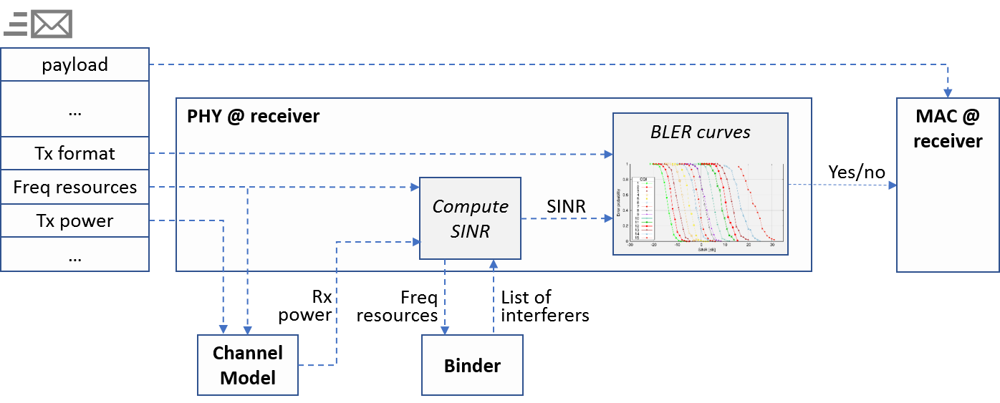
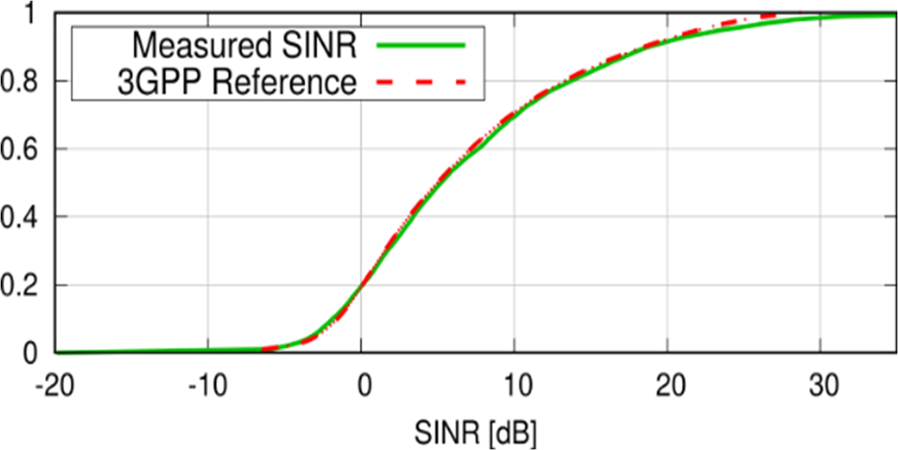

The Physical Layer and Channel Models
=====================================

Overview
--------

Simu5G models the physical layer at the level of transport blocks and
resource blocks, not OFDM symbols. When a MAC PDU is transmitted, it is
encapsulated in an air frame message and delivered to the receiver's PHY,
which applies a channel model to compute the received power, queries the
``Binder`` for the set of nodes interfering on the same resources, computes
the per-resource-block SINR, and uses Block Error Rate (BLER) curves to
turn SINR and transport format into a probability of correct reception of
the whole PDU. This abates the computational cost of decoding by orders of
magnitude while preserving correctness of the results.

Simu5G's PHY model has been validated in compliance with the calibration
guidelines of 3GPP RP-180524: in the Urban Macro scenario prescribed there,
the SINR distribution obtained with Simu5G matches the reference
distribution.

PHY modules
-----------

``PhyBase`` implements the functionality common to all nodes; ``PhyEnb``
and ``PhyUe`` add the base-station and UE sides. User-relevant parameters
include the transmission powers (``ueTxPower``, ``eNodeBTxPower``,
``microTxPower``), antenna directionality (``txDirection``: ``"OMNI"`` or
``"ANISOTROPIC"``, with ``txAngle``), and on the base station side the
handover beaconing switches (``enableHandover``, ``enableBeacons`` -- see
:doc:`handover`).

Since channel effects are carrier-dependent, each NIC holds a *vector* of
channel model submodules, one per component carrier the node is bound to
(see :doc:`carriers`).

Channel models
--------------

Channel models implement the ``IChannelModel`` module interface and are
selected per NIC via the channel model submodule's ``typename``. The
provided models:

``StochasticChannelModel``
   The full statistical link model: path loss with LOS/NLOS states,
   log-normal shadowing, fast fading, inter-cell interference, and the
   SINR-to-BLER mapping. This is the workhorse for performance studies.

``Tr36873ChannelModel``, ``Tr38901ChannelModel``
   Presets of ``StochasticChannelModel`` selecting the 3GPP TR 36.873 (3D
   channel model for LTE) and TR 38.901 (0.5--100 GHz) path loss models
   respectively. TR 38.901 is the default for gNBs and the NR leg of UEs.

``IdealChannelModel``
   No propagation modeling at all -- reception is decided by a configured
   constant packet error rate (``per``, with direction-specific variants).
   Useful for protocol-level validation and debugging, not for performance
   evaluation.

Key parameters
--------------

The main parameters of ``StochasticChannelModel``:

*  *Path loss*: ``pathLossType`` (``"Tr36814"``, ``"Tr36873"``,
   ``"Tr38901"``) and ``scenario`` (``INDOOR_HOTSPOT``,
   ``URBAN_MICROCELL``, ``URBAN_MACROCELL``, ``RURAL_MACROCELL``,
   ``SUBURBAN_MACROCELL``); LOS/NLOS is controlled by ``dynamicLos`` /
   ``fixedLos``.
*  *Shadowing*: ``shadowing`` (on by default), ``correlationDistance``.
*  *Fast fading*: ``fading``, ``fadingType`` (``"JAKES"`` or
   ``"RAYLEIGH"``), ``numFadingPaths``.
*  *Interference*: per-source switches ``downlinkInterference``,
   ``uplinkInterference``, ``extCellInterference``, ``bgCellInterference``.
*  *Link budget*: antenna gains, noise figures, ``thermalNoise``,
   ``cableLoss``.
*  *Reception*: ``targetBler``, ``harqReduction`` (the SINR benefit of HARQ
   retransmission combining).

.. TODO: document the per-scenario applicability ranges (frequencies,
   distances, antenna heights) of the path loss models, and what happens
   outside them.

Channel feedback
----------------

Channel state reporting is generated by the ``LteDlFeedbackGenerator``
module of the UE NIC: periodic (default) or aperiodic CQI reports, with
``fbPeriod`` and ``fbDelay`` timing parameters and a ``feedbackType`` of
``"ALLBANDS"``, ``"PREFERRED"`` or ``"WIDEBAND"``. The reports feed the
AMC module at the base station (:doc:`mac`), which summarizes them
according to its ``pilotMode``.

For D2D links, feedback works differently (per-link reporting or
preconfigured transmission parameters); see :doc:`d2d`.

Statistics
----------

The channel model records the received and measured SINR per direction
(``rcvdSinrDl``/``Ul``, ``measuredSinrDl``/``Ul``), and the UE PHY records
the average reported CQI (``averageCqiDl``/``Ul``); see :doc:`results`.
