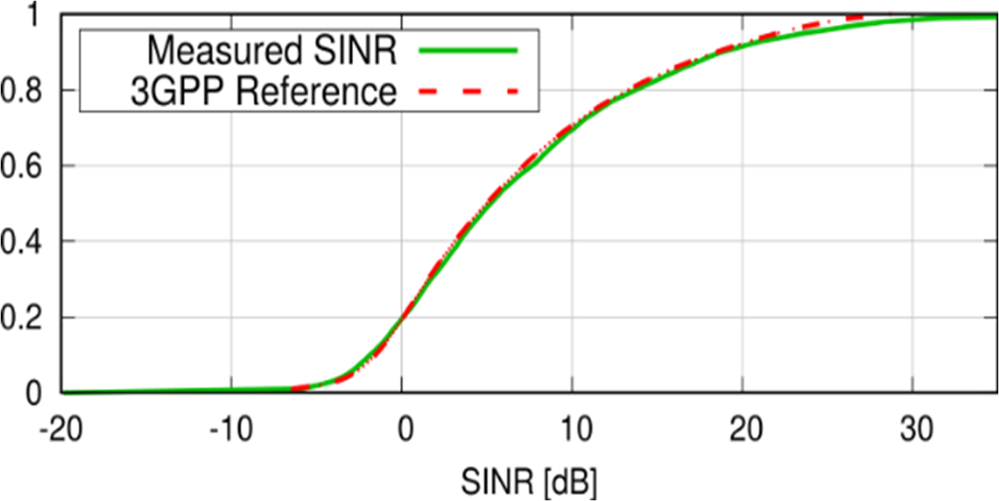

The Radio Medium and Channel Models
===================================

.. TODO: This chapter covers: CellularRadioMedium, the per-carrier channel models, LOS/shadowing/fading state, the reception trace; the RP-180524 calibration.

Channel models
--------------

Channel models implement the ``IChannelModel`` module interface and are
selected per NIC via the channel model submodule's ``typename``. The
provided models:

``StochasticChannelModel``
   The full statistical link model: path loss with LOS/NLOS states,
   log-normal shadowing, fast fading, inter-cell interference, and the
   SINR-to-BLER mapping. This is the workhorse for performance studies.

``Tr36873ChannelModel``, ``Tr38901ChannelModel``
   Presets of ``StochasticChannelModel`` selecting the 3GPP TR 36.873 (3D
   channel model for LTE) and TR 38.901 (0.5--100 GHz) path loss models
   respectively. TR 38.901 is the default for gNBs and the NR leg of UEs.

``IdealChannelModel``
   No propagation modeling at all -- reception is decided by a configured
   constant packet error rate (``per``, with direction-specific variants).
   Useful for protocol-level validation and debugging, not for performance
   evaluation.

Channel control
---------------

``LteChannelControl`` (``src/simu5g/world/radio/``) keeps a registry of
all radio-capable modules and their positions, so that transmissions can be
delivered to the modules they may affect. It plays the same role INET's
radio medium module plays for INET wireless models. Exactly one instance is
required per network; its parameters rarely need to be changed.

Calibration
-----------

Simu5G's PHY model has been validated in compliance with the calibration
guidelines of 3GPP RP-180524: in the Urban Macro scenario prescribed there,
the SINR distribution obtained with Simu5G matches the reference
distribution.

